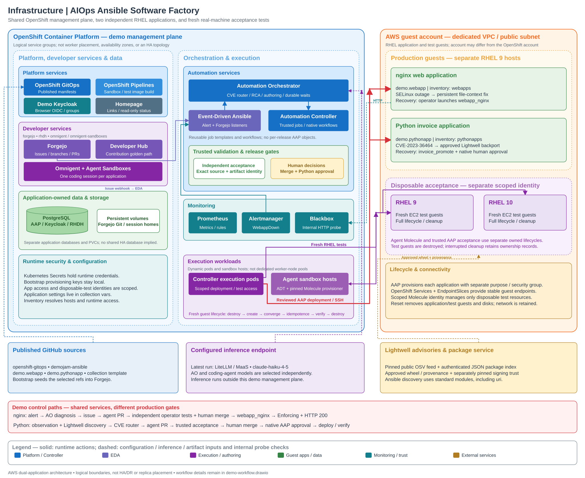

# Architecture and workflow diagrams

These files are **raw, uncompressed UTF-8 Draw.io XML**. They contain editable
`mxCell` shapes, labels, connectors and geometry; no embedded screenshots,
compressed diagram payloads, credentials, runtime hostnames or remote assets.

| File | Pages | Purpose |
| --- | --- | --- |
| [demo-architecture.drawio](demo-architecture.drawio) | Architecture | OpenShift management plane, source/inference/artifact services, two production RHEL hosts, and disposable AWS acceptance hosts. |
| [demo-workflow.drawio](demo-workflow.drawio) | 01 Walkthrough | One preparation, two independent triggers and different human gates. |
| Same workflow file | 02 Reset and prepare | Source selection, model checks, reset/bootstrap, distinct baselines and readiness before both triggers. |
| Same workflow file | 03 nginx outage | Fault, availability alert, RCA, issue/EDA handoff, authoring, independent operator tests, merge and one recovery launch. |
| Same workflow file | 04 Python patch | Observation, Lightwell discovery, CVE route, authoring, trusted independent acceptance, merge, native approval, reusable deployment and verification. |
| Same workflow file | 05 CVE alternatives | Patch, approved temporary containment, manual review and deferred evidence paths, with their validation limits. |

## Architecture preview

[Open the SVG preview](demo-architecture.svg) or download the
[editable Draw.io XML](demo-architecture.drawio).

The architecture layout takes inspiration from the
[AAP infrastructure reference](https://ansible-tmm.github.io/solution-guides/assets/images/aap-hadr-full-architecture.png):
nested boundaries, compact component groups and separate external services.
Blue outlines group the OpenShift management plane; orange outlines group AWS
application and test hosts. These are logical service groups, not availability
zones or an HA/DR deployment. Purple marks execution and authoring, green marks
applications and data, and teal marks monitoring and runtime configuration.
The SVG provides a vector preview of the same geometry and labels as the editable
XML; neither file embeds bitmap images or remote assets.

## Open or reuse the XML

Open a `.drawio` file directly in diagrams.net/Draw.io using **File → Open from →
Device**, or import it into an existing document. Use the page tabs for workflows.
The `.drawio` extension identifies the application; the contents are ordinary XML.
To transfer raw code, copy the complete file from `<?xml ...?>` through `</mxfile>`
into a text file and open it in Draw.io. Do not replace it with a raster image or
copy an entire `mxfile` into a dialog expecting only one `mxGraphModel`.

## Reading the diagrams

In the workflow diagrams, blue denotes automated work; amber denotes human-controlled gates/actions; green
marks verification/recovery; purple marks inference, artifacts or policy review;
gray marks supporting services and boundaries. Red notes identify failure handling.
Architecture arrows are schematic interactions, not an exhaustive network-policy
or secret-mount specification. Dashed architecture arrows identify configuration, inference and artifact inputs,
as well as the internal HTTP probe check. Solid arrows show runtime actions.

For a timed presentation, use the [three-presenter script](../demo-script.md).
For a walkthrough, start on page 01, show the architecture, then use page 02 once.
Follow page 03 for nginx and page 04 for Python; use page 05 to explain alternatives.
Application provisioning does not trigger an incident. Agent completion, PR closure,
a signature, or an OIDC login response alone does not prove production recovery.

## Source and evidence boundary

The diagrams reflect the [current-state record](../stable-demo-rehearsal.md),
[operator runbook](../invoice-lightwell-demo.md),
[AO definitions](../../cluster/automation-orchestrator/workflows/README.md), and
trusted AAP content in `demojam-ansible`. The 2026-10-28 clean run used AWS,
separate RHEL 9 production hosts, fresh RHEL 9/10 tests and LiteLLM/MaaS
`claude-haiku-4-5` for both consumers. The patch route and nginx recovered together.
Alternative mitigation routes have isolated fixture coverage; CNV was not used
in that dual-app run. That earlier rehearsal took 66.8 minutes. The latest
[scripted walkthrough](../demo-script.md) covers a 35-minute parallel incident run
and 79.5 minutes including reset, preparation and connectivity retries; both
measurements include operator actions.

nginx recovery is operator-launched through the existing AAP wrapper. Python
uses a reusable native `invoice_promote` approval graph. A failed independent
Python check stops orchestration; an automatic agent CI-repair loop and a native
nginx promotion workflow remain deferred. Containment stops service and leaves
the dependency vulnerable; it does not close the incident.

Keep the XML aligned with checked-in behavior. Preserve stable page/cell IDs when
editing and use orthogonal connectors. Validate well-formed XML, unique IDs,
edge endpoints, page bounds, and relative documentation links before publication.
