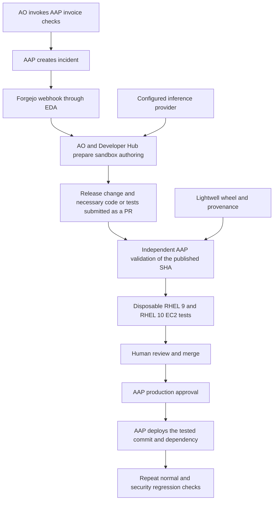

# Invoice remediation with the Ansible software factory

This demonstration turns a security incident in a RHEL invoice-processing
application into reviewed Ansible content and an approved AAP deployment.
Automation Orchestrator coordinates the work. Lightwell supplies a patched
PyPDF2 dependency; the agent updates a locked application release and authors the regression
coverage or Ansible changes needed for that finding. Most of the five-minute recording follows AO, the
Ansible changes, machine tests, review, and AAP execution.

## Original abstract and the AWS deployment

The submitted abstract remains the organizing description:

> The AIOps Ansible Software Factory transforms automation intent (alerts,
> chats, or tickets) into tested, reviewed, and deployed Ansible content.
> Orchestrated via Red Hat Ansible Automation Orchestrator, AI agents perform
> the bulk of the automation authoring inside highly secure environments
> leveraging the Red Hat build of Agent Sandbox, while human developers hold
> the merge and production gates. Red Hat Developer Hub serves golden paths
> for AI Agents powered by Openshift AI, and generated content is rigorously
> tested against ephemeral, real-machine guests using OpenShift Virtualization
> to ensure production readiness.

For this AWS environment, the application and ephemeral test guests are EC2
instances. OpenShift hosts the management plane and agent sandboxes. The
recording must identify the real-machine tests as RHEL on EC2. OpenShift
Virtualization is the existing alternative backend; it is not used or
demonstrated by this AWS invoice scenario.

The OpenShift AI claim requires an actual OpenShift AI model endpoint. Set
`MODEL_PROVIDER=openshift-ai` and the endpoint, model, and API key. An external
endpoint is sufficient; the inference cluster need not be the management
cluster. Record the actual inference service used by both consumers.

## Business scenario

An accounts-payable portal extracts text from uploaded PDF invoices. Its
approved application release depends on PyPDF2 3.0.1. Ordinary invoices work,
but a PDF content stream containing an EOF-terminated comment stalls text
extraction because of CVE-2023-36464.

The service runs each extraction in a separate process with the same two-second
deadline in every release. A stalled worker is terminated and reported as
`timed_out`; health requests remain available. The bounded demonstration
therefore shows failed invoice processing, not an unlimited server outage.
Two concurrent extraction slots and systemd resource limits further bound the
demonstration. These controls do not constitute remediation of the library.

The durable result must process the identical regression document correctly,
preserve normal invoice extraction, and run the actual Lightwell-patched
artifact. Restarting the service, extending a timeout, replacing the document,
or changing the parser package does not meet the acceptance criteria.

The upstream advisory lists no patched PyPDF2 release and recommends migration
to pypdf. The Lightwell build lets this scenario demonstrate a security
backport while retaining the application's PyPDF2 baseline. Stock PyPDF2
3.0.1 is the vulnerable release; its version alone is not proof of remediation.

For editable architecture, preparation, nginx, Python and CVE-routing diagrams,
see [the Draw.io XML files](diagrams/README.md). The
[current-state record](stable-demo-rehearsal.md) identifies tested revisions and limits.

## Components and responsibilities

| Component | Responsibility |
| --- | --- |
| AO | Run the evidence-gathering and issue workflow; coordinate the agent handoff and independent validation. |
| AAP | Observe application behavior, create the ticket, independently validate the candidate, require production approval, and execute the reviewed content. |
| Developer Hub | Validate the issue and prepare its contribution branch through the existing golden path. |
| Agent Sandbox and Omnigent | Host the authoring session with source access and scoped disposable-test credentials. |
| Configured inference provider | Serve AO and coding models independently; the latest clean run used LiteLLM/MaaS Claude Haiku for both. OpenShift AI is an optional provider. |
| Lightwell | Provide the selected remediated wheel and its provenance. |
| RHEL on EC2 | Host the application and the ephemeral RHEL 9 and RHEL 10 tests. |
| Forgejo | Host the seeded collection, incident, review, required status, and protected branch. |
| OpenShift Pipelines | Build the authoring and validation execution image containing ADT, AWS provisioners, and Cosign. |
| OpenShift GitOps | Reconcile the management-plane configuration from published commits. |

The application is installed into an immutable Python environment on RHEL and
managed by systemd. A release directory includes the exact dependency wheel,
application source, and release evidence. It is identified by the wheel hash
and collection commit. AAP changes the active release symlink and restarts the
service. This implementation does not claim a container-image application
rollout or zero downtime.



## Repositories and the authoring boundary

The implementation spans four sibling repositories:

| Repository | Files and purpose |
| --- | --- |
| `openshift-gitops` | `bootstrap/bootstrap.sh`, invoice AO workflows, image tooling, Make targets, configuration examples, and this runbook. |
| `demojam-ansible` | `playbooks/invoice/`, `playbooks/aap/configure-invoice.yml`, inventory configuration, and the invoice EDA rule. |
| `ansible-collection-demo.webapp` | Independent nginx/SELinux collection for the `webapps` RHEL host. |
| `ansible-collection-demo.pythonapp` | Invoice application, reusable Python deployment role, dependency release lock, remediation golden path, and candidate Molecule scenario for the `pythonapps` RHEL host. |

The reusable `python_application` role handles artifact identity, pinned signing
trust, provenance, isolated release installation, activation and rollback. It
contains no PyPDF2 identity, CVE ID or baseline digest. The application vars file supplies its source and business probe directly.

The seeded `releases/invoice.json` locks the baseline. Each incident asks the
agent to update that release manifest to the exact operator-approved Lightwell
package/version/digest and add appropriate tests. `invoice-remediate.yml` is
already a working golden path, not a one-time missing-playbook exercise. It
rejects the baseline lock, an incompatible artifact or an unapproved digest.
Automation changes belong in the PR only when the incident needs them.

Independent AAP validation runs both the candidate's tests and a separate trusted
acceptance scenario from `demojam-ansible`. The agent has read-only access to
that repository. The mandatory suite provisions its own RHEL 9/10 EC2 guests,
checks wheel bytes and actual installed package metadata, supplies independent
normal/regression PDFs, enforces SELinux, and exercises a real first-host
activation failure using a disposable systemd override. It requires rollback
and an untouched follower, removes the fault, redeploys and verifies the fix.
No production fault-injection switch is added to the role.

The human merge and AAP production approval gates remain. Do not describe the
prebuilt deployment/provenance machinery as agent-authored. Record the actual
release/test/Ansible diff and exact published commit.

## Application profiles and repeat incidents

`demo/invoice/profile.json` is operator-controlled policy, mounted with runtime
material outside the agent checkout. It defines application/environment identity,
package, target wheel tags, explicit affected/fixed advisory versions and sources,
business checks, optional regression, baseline behavior and acceptance adapter.
Override it with `REMEDIATION_PROFILE_FILE`; override the initial baseline with
`REMEDIATION_BASELINE_FILE`. Keep credentials outside profiles and release locks.

The observation job reads package metadata directly from the configured application
Python executable (`application.python_executable`) and collects business
results for every target host. Advisory attribution comes from the profile,
not from a timeout. An unknown version is unclassified, not proven fixed.
Verification additionally requires the exact approved version and artifact.

Bootstrap and `invoice_discover` use the collection's `lightwell` role, composed
only of built-in Ansible modules. The role downloads an immutable revision of
Lightwell's public OSV advisory feed and matches the package, backport base
version and complete requested CVE set. It then requests the authenticated
Python index with `Accept: application/vnd.pypi.simple.v1+json` and joins the
vendor fix version to a non-yanked compatible wheel, SHA256 and provenance URL.
The profile supplies allowed wheel tags and `requires_python` strings for the
configured runtime; unrecognized runtime requirements are not selected.

One unambiguous eligible artifact is selected. Multiple fixes stop preparation
unless `INVOICE_LIGHTWELL_ARTIFACT_FILE` pins the exact version, filename and
hash. No vendor-backed fix yields an empty selection and no authoring dispatch.
New preparation resolves the current vendor feed commit before downloading it;
the selected artifact records that immutable `advisory_revision`. AAP repeats
discovery using the prepared snapshot. An explicit role revision can pin a
reviewed snapshot instead. No console API credentials or production OSV
ingestion are required.

Bootstrap writes the discovered selection and vendor-backed fixed versions to
private prepared material only after success, then distributes that same
immutable selection to AAP and the sandbox. AAP repeats read-only discovery
against the prepared pin; it never changes production's approved artifact by
resolving "latest". Artifact provenance verification, separately pinned signing
trust, release-lock assertions and mandatory RHEL acceptance remain independent.

Incident identity combines application, environment, normalized package and advisory
set. Ticket reconciliation paginates through history, refreshes an existing open
incident, creates a new occurrence after a closed incident when the problem returns,
and can close an open incident only after observing a configured fixed version.
A finding without a supported fix is reported but does not start an authoring task.
One AO detection execution handles one application profile; fleet observations are
included in its ticket. EDA dispatches only newly opened remediation tickets.

To add another application, supply its profile, package/version advisory mapping,
artifact and release lock; register its trusted application acceptance adapter and
candidate scenario. Package trust and AO orchestration stay the same. Business
validation remains application-specific: a SQL parser needs SQL checks, not PDFs.
Profiles using a new adapter fail closed until that adapter is reviewed.

The initial deployment adapter handles one self-contained wheel. It rejects required
transitive dependencies instead of using an unpinned network resolution. Native
wheels require explicit compatible target tags; arbitrary dependency closures and
native-runtime qualification need a corresponding reviewed adapter.

`demo/invoice/sqlparse-profile.example.json` is an incomplete second application
example and cannot be used for material hydration until approved/completed.
On 2026-10-20 the shared discovery parser found the real compatible catalog wheel
`sqlparse-0.5.5+rhlw.1-1-py3-none-any.whl`. This establishes catalog discovery only;
its advisory mapping, application integration and EC2 remediation have not been
validated. Policy and wheel-metadata tests exercise both package names using
explicitly synthetic test fixtures, without fabricating a second successful demo.

## Separate nginx and Python applications

Use `DEMO_BACKEND=aws` and `DEMO_SCENARIO=both` to deploy both applications. The legacy `invoice` selection also enables the separate Python host alongside nginx. `selinux` retains the nginx-only setup. The same management plane serves both workflows; their application repositories, purpose tags, inventory groups and browser endpoints are distinct.

| Scenario | Collection/repository | Production group | Browser endpoint | Trigger |
| --- | --- | --- | --- | --- |
| nginx SELinux outage | `demo.webapp` / `ansible-collection-demo.webapp` | `webapps` | `https://webapp.<ingress-domain>` | `aap launch webapp_selinux_enable` |
| Python dependency vulnerability | `demo.pythonapp` / `ansible-collection-demo.pythonapp` | `pythonapps` | `https://pythonapp.<ingress-domain>` | `make invoice-trigger BACKEND=aws` |

Bootstrap installs the baselines without triggering either incident. For a requested
`both` rehearsal, reset/bootstrap once, run invoice detection, and also launch
`bash bootstrap/bootstrap.sh aap launch webapp_selinux_enable`. Follow the invoice
workflow here and the nginx workflow in `.agents/skills/run-demojam/SKILL.md`.
Record separate outcomes; a failure in one scenario does not skip the other.

Developer Hub receives an allowlisted repository and issue number. For Python tasks, the native helper uses `demo-goldenpath --repository demo-owner/ansible-collection-demo.pythonapp checkout N` and the same option for `pr`. Nginx keeps its default repository. EDA routes new security incidents using the Python repository plus structured remediation marker; it does not require the nginx RCA text `Root Cause:`.

## Upgrade an existing rehearsal

When upgrading the old shared-host invoice rehearsal, preserve `.rendered/invoice/` and select the four coordinated source refs in the current-state guide. Run `make applications-upgrade BACKEND=aws` rather than resetting the environment. Its preparation command archives/removes only the former invoice-specific protection on the nginx repository, and refuses while that repository has open PRs. Bootstrap then seeds the split contents, provisions/verifies the Python baseline first, stops the legacy invoice unit on the nginx host while retaining its release files, and prepares nginx there. Run `make invoice-protect BACKEND=aws` afterward to protect the Python collection. Existing incidents and job evidence remain historical; trigger a new incident in the Python repository.

These changes replace the previous one-time authoring stub. The old Forgejo agent
PR is historical evidence and is not a passing candidate for the revised workflow.
Do not silently edit that branch or reuse its validation claims. Finish/stop any
active authoring run before reseeding the new committed collection and trusted AAP
content using the normal preparation commands. Refresh material, reconfigure AAP
and its projects, reinstall the baseline if a clean recording is needed, then
trigger a fresh incident. Preserve or archive the previous incident/PR transparently;
do not merge it as the new release. Keep GitHub implementation PRs unmerged while
rehearsing their feature branches.

## Required operator inputs

Copy `.env.invoice.example` into a private `.env`, preserving the AWS values
already supplied when updating an existing file. Run `chmod 600 .env`.
The scripts source trusted Bash configuration; secret values stay outside Git.

| Input | Required value |
| --- | --- |
| `DEMO_BACKEND` | `aws` |
| `DEMO_SCENARIO` | `both` (legacy `invoice` also enables Python) |
| AWS bootstrap keys | An authorized provisioning identity. Bootstrap creates separate scoped application and test identities. |
| `AAP_LICENSE_FILE` | A real AAP subscription manifest ZIP. |
| OpenShift AI fields | HTTPS API base URL, model name, and token. Both AO and Omnigent can override these independently. |
| `INVOICE_LIGHTWELL_ARTIFACT_FILE` | Optional approval pin: exact discovered Lightwell wheel version, filename and SHA256. Leave empty for an unambiguous vendor-advised fix. |
| Lightwell username and token | A dedicated repository-read identity. |
| `INVOICE_SIGNING_KEY_FILE` | Trusted public Red Hat signing key in PEM format. |
| `INVOICE_SIGNING_KEY_SHA256` | Independently checked SHA256 of that public-key file. |
| `INVOICE_TEST_EE_IMAGE` | An immutable `@sha256:` execution image, or leave empty to resolve the successfully built sandbox image. |

The optional approval descriptor uses this structure. Ansible discovers these
values when no descriptor is supplied; a supplied descriptor must match discovery.

```json
{
  "channel": "lightwell",
  "package": "PyPDF2",
  "base_version": "3.0.1",
  "version": "EXACT_LIGHTWELL_DISTRIBUTION_VERSION",
  "filename": "EXACT_LIGHTWELL_WHEEL_FILENAME.whl",
  "url": "https://packages.redhat.com/EXACT_ARTIFACT_PATH",
  "sha256": "EXACT_64_CHARACTER_SHA256",
  "provenance_url": "https://packages.redhat.com/EXACT_PEP740_PROVENANCE_PATH",
  "cves": ["CVE-2023-36464"]
}
```

The verifier checks the bytes and wheel metadata, verifies the PEP 740 envelope
with Cosign and the pinned public key, and checks the SLSA statement's subject
digest. It follows Red Hat's documented key-based verification procedure,
which disables transparency-log verification while retaining signature and
artifact-digest verification. Downloaded credentials and provenance are staged
privately in the execution environment; repository credentials are not copied
to the application guest.

An absent Lightwell descriptor permits preparation of the known upstream
baseline. It cannot produce a successful remediation or independent validation.
Never substitute a locally edited wheel or a migrated pypdf package and label
it a Lightwell remediation.

## Select the current implementation

See [current state and tested commits](stable-demo-rehearsal.md) before setup.
The following published branches include the fixes exercised by the latest clean
run. These are source selectors, not incident branches. Set them in the shell
for the bootstrap/reset commands, or maintain equivalent values privately in
`.env`; never print or commit credentials:

```bash
export BOOTSTRAP_REPO_URL='https://github.com/aiops-ansible-software-factory-demojam/openshift-gitops.git'
export BOOTSTRAP_BRANCH='fix/portable-collection-artifacts'
export ANSIBLE_COLLECTION_DEMO_WEBAPP_BRANCH='fix/portable-collection-artifacts'
export ANSIBLE_COLLECTION_DEMO_PYTHONAPP_BRANCH='fix/ansible-review-contracts'
export DEMOJAM_ANSIBLE_BRANCH='fix/ansible-review-contracts'
export ANSIBLE_COLLECTION_TEMPLATE_BRANCH='main'
export DEMO_LOCAL_SOURCES=''
```

Bootstrap checks that the local GitOps HEAD matches its published revision.
It fetches the companion branches and seeds their committed contents into the
demo's Forgejo repositories. The later Forgejo remediation PR belongs to the
recorded software-factory workflow; its human merge does not merge any of the
GitHub implementation PRs.

The latest clean run used MaaS through the LiteLLM provider for both consumers:

```bash
export AO_MODEL_PROVIDER='litellm'
export AO_MODEL='claude-haiku-4-5'
export AO_MODEL_PROTOCOL='chat'
export OMNIGENT_MODEL_PROVIDER='litellm'
export OMNIGENT_MODEL='claude-haiku-4-5'
export OMNIGENT_MODEL_PROTOCOL='chat'
```

Supply your HTTPS API base and key privately through `LITELLM_ENDPOINT` and
`LITELLM_API_KEY`, or the per-consumer endpoint/key overrides. Do not append
`/chat/completions` to the configured API base. Verify both consumers before reset;
model availability depends on the endpoint. `make model-config` applies selections;
new coding sessions use the new configuration. Other supported providers remain
valid but must be described accurately in any recording.

AAP execution copies do not contain `.git`. When a job overrides its SCM source,
validation requires the protected `awx_job_scm_branch` to equal the approved full
SHA. Only a job without an override uses `awx_project_revision` for the default
project revision. Direct runs require matching clean Git HEAD. Independent
validation checks a fresh checkout of the exact published candidate.

## Prepare the environment

The first command checks inputs without printing their values:

```bash
make invoice-inputs BACKEND=aws
```

For development from committed sibling checkouts, set `DEMO_LOCAL_SOURCES` to
their parent directory and select their local branch names in the companion source
override fields. Dirty sources are rejected. The Ansible template repository
continues using its published release unless a matching local checkout exists.

Install the management foundation and create the dedicated AWS network and
scoped identities:

```bash
make invoice-foundation
```

The foundation can be prepared before the model and Lightwell inputs arrive.
It does not constitute a completed application or authoring demonstration.
The normal full bootstrap still requires the AAP subscription and model inputs.

Commit all implementation changes. To publish the GitOps implementation into
the demo's Forgejo instance, without requiring GitHub write access:

```bash
make invoice-publish BACKEND=aws
```

Set the printed `BOOTSTRAP_REPO_URL` and `BOOTSTRAP_BRANCH` in `.env`. Argo CD
must read the actual published implementation. Publication also registers the
foundation applications with Argo CD. Omnigent, Homepage, and user-workload
monitoring are deferred until full bootstrap supplies their runtime inputs.
Run the full setup:

```bash
make bootstrap BACKEND=aws
```

Both-application mode provisions two EC2 RHEL hosts. The `webapp` host runs only nginx and uses the explicit permissive setup required by its SELinux demonstration. The separate `pythonapp` host runs the invoice baseline in enforcing mode; invoice deployment, observation and promotion target only `pythonapps`. Changing SELinux on `webapps` cannot alter the Python host. Each host has a distinct purpose tag, security group, EC2 key name, inventory source and endpoint. Test guests are created and removed by Molecule through the AWS
provisioner; no OpenShift Virtualization operators or VM guests are required.

Refresh artifact material and configure AAP after supplying or changing the
Lightwell selection:

```bash
make invoice-material BACKEND=aws
make invoice-configure BACKEND=aws
bash bootstrap/bootstrap.sh invoice verify vulnerable --backend aws
make invoice-protect BACKEND=aws
```

Protection disables direct pushes to collection `main`, requires one human
review and the `invoice/ec2-validation` status, dismisses stale approvals,
and applies to administrators. The seeded `demo-reviewer` identity and enabled
human identities in `DEMO_USERS_FILE` with the `demo-admins` group can merge.
For SSO users such as `demo-user`, sign into Forgejo first, then run
`make invoice-protect BACKEND=aws` to reconcile their merge access. The username
and email must match the configured identity; accounts and passwords are preserved.
Both application repositories grant these reviewers write access. Keep the
agent's identity separate from these human identities.
Protection also reduces the agent's access to `demojam-ansible` to read-only,
so it cannot rewrite the independent validator or AAP configuration.
Publish and hydrate source changes before protecting the recording baseline.

## Run the complete demonstration

1. Open the portal from Homepage's Python invoice app link. Process the sample invoice.
   Run the regression document and capture `timed_out`, its document SHA256,
   installed dependency identity, and elapsed time.
2. Run `make invoice-trigger BACKEND=aws`, or start `invoice-security-detect`
   in AO. AAP gathers real observations and opens one deduplicated incident.
   Its Forgejo opening webhook reaches EDA and starts the invoice authoring
   workflow. A repeat detection reuses the open incident.
3. Follow the AO execution into Developer Hub and the Omnigent session. Record
   the actual issue, branch, model, agent session, and eventual PR. During the
   authoring demonstration, do not privately edit the agent's branch or supply
   corrective code and conceal that intervention.
4. Follow the same AO execution as it discovers the submitted PR and publishes
   a pending required check. AO runs `invoice_validate` against the exact head,
   then publishes the independently proven result. The trusted validator lints,
   builds and tests candidate and mandatory acceptance on RHEL 9/10, including
   idempotence, regression, rollback and destruction. Agent-reported tests alone
   cannot satisfy the protected branch check.
5. Review the actual diff and independent evidence as a human, then approve and
   merge in Forgejo. AO observes the merge. A changed head, rejected/closed PR or
   missing main ancestry stops the flow; it never automatically merges a PR.
6. AO calls `invoice_prepare_release` and launches the reusable `invoice_promote`
   workflow with the exact tested SCM commit and a public release contract.
   That contract binds source, wheel, profile, material and execution image. Its reusable `invoice_deploy` job consumes the shared artifact
   credential only after checks bind its contents to trusted acceptance.
7. Open the AAP workflow from the AO production node and approve the production
   gate as a human. Rejection or timeout cannot deploy. The workflow never
   approves this gate automatically.
8. AO checks the actual approval and deployed job evidence, then verifies the
   exact running dependency/source and application business/regression behavior.
   Only a successful verification reaches incident reconciliation. Repeat the
   identical regression PDF and normal invoice in the browser and record the
   source revision, version, wheel digest and AAP/AO execution IDs.

The existing manual commands remain recovery tools, not extra steps to launch
alongside a running continuous execution:

```bash
make invoice-validate BACKEND=aws SHA=<published-head-sha>
make invoice-promote BACKEND=aws PR=<merged-pr-number> JOB=<validation-job-id>
make invoice-verify BACKEND=aws
```

Inspect the original AO/AAP execution before recovery. Existing issue branches
suppress duplicate authoring deliveries. The wait policy and deployment order are
documented in `cluster/automation-orchestrator/workflows/README.md`.

## Five minute recording and narration

Use the canonical [three-presenter demo script](demo-script.md). It covers both
Lightwell/Python and nginx/SELinux in one five-minute walkthrough, with exactly
100 seconds per presenter and two clean handoffs:

1. Presenter 1 (0:00–1:40): architecture, both baselines and both incident triggers.
2. Presenter 2 (1:40–3:20): Lightwell discovery, authoring, independent acceptance,
   human merge, native production approval and verified Python recovery.
3. Presenter 3 (3:20–5:00): nginx alert/RCA, code and regression tests, independent
   validation, human merge, operator AAP recovery and final proof for both apps.

The script includes spoken narration, screen directions and transition cues.
Use one complete recorded run and label measured waits; the five-minute edit
must not be described as the real incident duration. Homepage and the
[Draw.io pages](diagrams/README.md) provide the walkthrough views.

There is one production host per application in the default AWS inventory.
Canary/rollback behavior is independently tested on disposable guests; do not
claim a production fleet rollout from a single Python production host.

## Acceptance criteria and evidence

- The baseline uses the recorded upstream PyPDF2 3.0.1 wheel and reproduces the
  real EOF-comment parsing loop within the bounded worker process.
- Normal invoices extract `Invoice INV-1042` and the expected invoice text.
- The exact same regression bytes work after the actual Lightwell artifact
  is installed; its signature, digest, and metadata have been checked.
- The reviewed PR contains the required release change and any necessary Ansible
  or regression additions. Existing golden-path content is identified as prebuilt;
  final candidate and trusted tests run on both RHEL versions through cleanup.
- Recovery testing establishes that a previous healthy release is restored
  after a failed candidate, and that the deployment still reports failure.
- SELinux remains enforcing; source and artifact identity checks remain active.
- Independent validation matches the published PR head, and production uses
  that tested commit after human merge and a separate approval.
- Any intervention, failed run, unavailable product integration, or deviation
  from the abstract is recorded accurately.

Store runtime identifiers, URLs, stage timings, job evidence, and recordings
outside Git under `.rendered/invoice/`. Record actual results; do not fill in
successful Lightwell or EC2 acceptance results before those runs complete.

## Rehearsal and cleanup

For another recording, first preserve the PR, job evidence, and timing record.
Use the existing disposable demo reset only when ready to discard its demo
repositories and guests. Reset removes EC2 guests and their disks and restores
the authoring baseline; full bootstrap is needed afterward. It is broader than
an application restart and should not run during an active agent session.

```bash
make demo-reset BACKEND=aws
make bootstrap BACKEND=aws
make invoice-protect BACKEND=aws
```

Reconcile the protection after reset. A normal application restart must not
reintroduce the vulnerable dependency. Full teardown also removes the owned
AWS network and scoped identities. Keep the provisioning receipts until
cleanup is complete.

## Technical references

- [PyPDF2 CVE and affected extraction path](https://github.com/py-pdf/pypdf/security/advisories/GHSA-4vvm-4w3v-6mr8)
- [Lightwell Python repository configuration](https://docs.redhat.com/en/documentation/lightwell_network/current/configure-configure_python_build_tool)
- [Lightwell Python wheel provenance verification](https://docs.redhat.com/en/documentation/lightwell_network/current/configure-verify_provenance_for_python_wheel_artifacts)
- [Lightwell patched artifact versions](https://docs.redhat.com/en/documentation/lightwell_network/current/get_started-patched_artifact_versions)
- [OpenCode Go models and endpoints](https://opencode.ai/docs/go/)
- [AAP job context and source revision](https://docs.ansible.com/projects/awx/en/24.6.1/userguide/job_templates.html)
- [Existing AWS and virtualization backend specification](specs/aws-cnv-backends.md)


## Reusable production promotion

`invoice-configure` installs the `invoice_prepare_release` and `invoice_deploy`
job templates plus the `invoice_promote` workflow once. Each promotion launch
uses a fresh release contract and an exact SCM commit, rather than creating
new AAP resources. The contract binds the validation job, incident/PR, wheel,
public artifact material, release manifest and execution image.

AAP runs a trusted release check before its 30-minute human approval and again
after approval. The latter proves the decision belongs to the same workflow
execution. Deployment verifies the current material and canonical release lock
against the saved contract before guest access; a credential/material change
causes failure rather than changing what was approved. AO then verifies the
actual guard jobs, approval, deployed source/image and business result.

A new independent validation is required after upgrading from the old per-release
path: old receipts do not contain `material_sha256`. Configuration leaves historic
per-release AAP resources intact, and does not modify running executions.

## CVE response routing

`invoice-security-detect` keeps its existing launch and the Forgejo → EDA → coding
agent trigger for application fixes. It now calls the trusted `invoice_route` JT
with the actual assessment and discovery job IDs before creating an authoring
issue. The router reads those jobs back from Controller, checks their successful
trusted templates/projects and the current profile digest, and requires complete
host observations. An API/discovery failure stops the run; it is not a no-fix result.

| Route | Decision | Outcome |
| --- | --- | --- |
| `app_patch` | Known affected application dependency; discovery confirms the prepared Lightwell artifact. | Existing authoring, independent acceptance, human merge and reusable production promotion. |
| `contain` | All scoped hosts are known affected; no confirmed approved fix; every advisory has a score; maximum score meets the policy threshold; service containment is configured. | Open a security response ticket, then run `invoice_contain` with a separate human approval. |
| `log_only` | Known lower-severity no-fix finding, or all hosts are known fixed. | Retain audit evidence; affected findings get a deferred-review ticket with an anchored UTC deadline. Verified fixed, healthy hosts reconcile existing tickets. |
| `manual_review` | Unknown version/severity, unsupported package ecosystem/control, or mixed fixed/affected hosts requiring containment. | Open/update a security review ticket; no automatic host change or coding session. |

Policy is operator data in `demo/invoice/profile.json`: each advisory may carry a
numeric `cvss_score`; `response` sets `high_severity_threshold`, `review_in_days`
(1–30), and `containment` (`stop_service` or `manual`). When no approved fix is available, missing scores require manual review; they never default
to low severity. The example's actual advisory score is 6.2, as published in
[GHSA-4vvm-4w3v-6mr8](https://github.com/advisories/GHSA-4vvm-4w3v-6mr8), so its no-fix
case is deferred rather than artificially presented as high severity. Containment
and escalation tests use clearly synthetic findings.

The containment graph is `validate-request → containment-approval → recheck-request
→ contain`. The guards re-read the real router and assessment receipts, bind the
saved request and current profile, and prove the approval belongs to this exact
workflow. The launch pins the configured application's SCM revision. Before
service changes, the collection checks that revision, workflow context, service,
policy and complete host scope, then reads the current installed version again.
Only the configured application service is stopped and disabled; its state is
verified afterward. No firewall, SSH, SELinux, package or unrelated host is changed.

This mitigation intentionally causes an application outage. It does **not** fix
the dependency or close the incident. Approval denial, timeout or failed checks
prevent containment; partial execution remains unsuccessful and needs review.
A later approved fixed release uses the existing deployment role, which enables
and starts the service, then verifies the application. A stopped service remains
assessable through its installed dependency, but does not pass business checks.
Only observed fixed versions with healthy business checks close authoring and
security response tickets.

Security response tickets use `<!-- security-response:... -->`, distinct from the
EDA authoring marker. Repeated detection updates the same open review and preserves
its first review deadline. The deadline is recorded for human follow-up; this
change does not install a scheduled retry or notification integration. The router sends non-PyPI ecosystems to manual review; the current detector collects
Python dependency evidence only. No generic OS detector, `dnf` or CME adapter is claimed.

Deploy coordinated published source refs, prepare material with the updated policy,
and apply `invoice-configure` plus AO configuration. The current patch route has
completed live acceptance; alternative routes retain isolated fixture coverage.
The baseline is tagged in all repositories as
`demo-baseline-before-cve-router-20261023`. Source changes and local/isolated checks
do not by themselves update the running demo.
