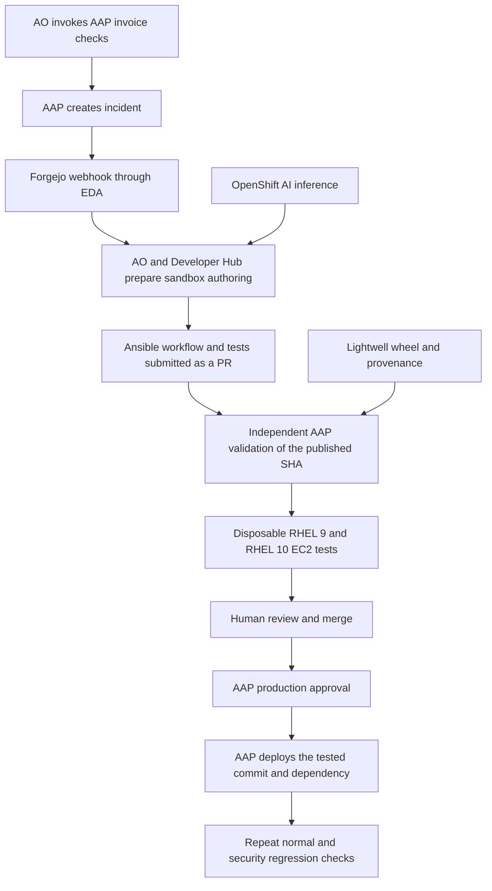

# Invoice remediation with the Ansible software factory

This demonstration turns a security incident in a RHEL invoice-processing
application into reviewed Ansible content and an approved AAP deployment.
Automation Orchestrator coordinates the work. Lightwell supplies a patched
PyPDF2 dependency; the agent updates a locked application release and authors the regression
coverage or Ansible changes needed for that finding. Most of the five-minute recording follows AO, the
Ansible changes, machine tests, review, and AAP execution.

## Original abstract and the AWS deployment

The submitted abstract remains the organizing description:

> The AIOps Ansible Software Factory transforms automation intent (alerts,
> chats, or tickets) into tested, reviewed, and deployed Ansible content.
> Orchestrated via Red Hat Ansible Automation Orchestrator, AI agents perform
> the bulk of the automation authoring inside highly secure environments
> leveraging the Red Hat build of Agent Sandbox, while human developers hold
> the merge and production gates. Red Hat Developer Hub serves golden paths
> for AI Agents powered by Openshift AI, and generated content is rigorously
> tested against ephemeral, real-machine guests using OpenShift Virtualization
> to ensure production readiness.

For this AWS environment, the application and ephemeral test guests are EC2
instances. OpenShift hosts the management plane and agent sandboxes. The
recording must identify the real-machine tests as RHEL on EC2. OpenShift
Virtualization is the existing alternative backend; it is not used or
demonstrated by this AWS invoice scenario.

The OpenShift AI claim requires an actual OpenShift AI model endpoint. Set
`MODEL_PROVIDER=openshift-ai` and the endpoint, model, and API key. An external
endpoint is sufficient; the inference cluster need not be the management
cluster. Record the actual inference service used by both consumers.

## Business scenario

An accounts-payable portal extracts text from uploaded PDF invoices. Its
approved application release depends on PyPDF2 3.0.1. Ordinary invoices work,
but a PDF content stream containing an EOF-terminated comment stalls text
extraction because of CVE-2023-36464.

The service runs each extraction in a separate process with the same two-second
deadline in every release. A stalled worker is terminated and reported as
`timed_out`; health requests remain available. The bounded demonstration
therefore shows failed invoice processing, not an unlimited server outage.
Two concurrent extraction slots and systemd resource limits further bound the
demonstration. These controls do not constitute remediation of the library.

The durable result must process the identical regression document correctly,
preserve normal invoice extraction, and run the actual Lightwell-patched
artifact. Restarting the service, extending a timeout, replacing the document,
or changing the parser package does not meet the acceptance criteria.

The upstream advisory lists no patched PyPDF2 release and recommends migration
to pypdf. The Lightwell build lets this scenario demonstrate a security
backport while retaining the application's PyPDF2 baseline. Stock PyPDF2
3.0.1 is the vulnerable release; its version alone is not proof of remediation.

## Components and responsibilities

| Component | Responsibility |
| --- | --- |
| AO | Run the evidence-gathering and issue workflow; coordinate the agent handoff and independent validation. |
| AAP | Observe application behavior, create the ticket, independently validate the candidate, require production approval, and execute the reviewed content. |
| Developer Hub | Validate the issue and prepare its contribution branch through the existing golden path. |
| Agent Sandbox and Omnigent | Host the authoring session with source access and scoped disposable-test credentials. |
| OpenShift AI | Serve the configured model used for authoring and AO inference. |
| Lightwell | Provide the selected remediated wheel and its provenance. |
| RHEL on EC2 | Host the application and the ephemeral RHEL 9 and RHEL 10 tests. |
| Forgejo | Host the seeded collection, incident, review, required status, and protected branch. |
| OpenShift Pipelines | Build the authoring and validation execution image containing ADT, AWS provisioners, and Cosign. |
| OpenShift GitOps | Reconcile the management-plane configuration from published commits. |

The application is installed into an immutable Python environment on RHEL and
managed by systemd. A release directory includes the exact dependency wheel,
application source, and release evidence. It is identified by the wheel hash
and collection commit. AAP changes the active release symlink and restarts the
service. This implementation does not claim a container-image application
rollout or zero downtime.



## Repositories and the authoring boundary

The implementation spans four sibling repositories:

| Repository | Files and purpose |
| --- | --- |
| `openshift-gitops` | `bootstrap/bootstrap.sh`, invoice AO workflows, image tooling, Make targets, configuration examples, and this runbook. |
| `demojam-ansible` | `playbooks/invoice/`, `playbooks/aap/configure-invoice.yml`, inventory configuration, and the invoice EDA rule. |
| `ansible-collection-demo.webapp` | Independent nginx/SELinux collection for the `webapps` RHEL host. |
| `ansible-collection-demo.pythonapp` | Invoice application, reusable Python deployment role, dependency release lock, remediation golden path, and candidate Molecule scenario for the `pythonapps` RHEL host. |

The reusable `python_application` role handles artifact identity, pinned signing
trust, provenance, isolated release installation, activation and rollback. It
contains no PyPDF2 identity, CVE ID or baseline digest. The `invoice_portal`
wrapper supplies its actual application source and business probe.

The seeded `releases/invoice.json` locks the baseline. Each incident asks the
agent to update that release manifest to the exact operator-approved Lightwell
package/version/digest and add appropriate tests. `invoice-remediate.yml` is
already a working golden path, not a one-time missing-playbook exercise. It
rejects the baseline lock, an incompatible artifact or an unapproved digest.
Automation changes belong in the PR only when the incident needs them.

Independent AAP validation runs both the candidate's tests and a separate trusted
acceptance scenario from `demojam-ansible`. The agent has read-only access to
that repository. The mandatory suite provisions its own RHEL 9/10 EC2 guests,
checks wheel bytes and actual installed package metadata, supplies independent
normal/regression PDFs, enforces SELinux, and exercises a real first-host
activation failure using a disposable systemd override. It requires rollback
and an untouched follower, removes the fault, redeploys and verifies the fix.
No production fault-injection switch is added to the role.

The human merge and AAP production approval gates remain. Do not describe the
prebuilt deployment/provenance machinery as agent-authored. Record the actual
release/test/Ansible diff and exact published commit.

## Application profiles and repeat incidents

`demo/invoice/profile.json` is operator-controlled policy, mounted with runtime
material outside the agent checkout. It defines application/environment identity,
package, target wheel tags, explicit affected/fixed advisory versions and sources,
business checks, optional regression, baseline behavior and acceptance adapter.
Override it with `REMEDIATION_PROFILE_FILE`; override the initial baseline with
`REMEDIATION_BASELINE_FILE`. Keep credentials outside profiles and release locks.

The observation job reads package metadata directly from the configured application
Python executable (`application.python_executable`) and collects business
results for every target host. Advisory attribution comes from the profile,
not from a timeout. An unknown version is unclassified, not proven fixed.
Verification additionally requires the exact approved version and artifact.

The AO detection workflow runs AAP catalog discovery before ticket reconciliation.
Run `make invoice-discover BACKEND=aws` after configuration to separately query the package's
Lightwell simple index using read credentials. The job returns compatible wheel
candidates and whether each has an approved advisory mapping. It never silently
selects "latest". An operator chooses a candidate, confirms its advisory mapping
and supplies the existing artifact/provenance descriptor before material refresh
and testing. Production uses the pinned selection, not a new catalog resolution.
A signature proves artifact provenance; it does not establish CVE coverage.

Incident identity combines application, environment, normalized package and advisory
set. Ticket reconciliation paginates through history, refreshes an existing open
incident, creates a new occurrence after a closed incident when the problem returns,
and can close an open incident only after observing a configured fixed version.
A finding without a supported fix is reported but does not start an authoring task.
One AO detection execution handles one application profile; fleet observations are
included in its ticket. EDA dispatches only newly opened remediation tickets.

To add another application, supply its profile, package/version advisory mapping,
artifact and release lock; register its trusted application acceptance adapter and
candidate scenario. Package trust and AO orchestration stay the same. Business
validation remains application-specific: a SQL parser needs SQL checks, not PDFs.
Profiles using a new adapter fail closed until that adapter is reviewed.

The initial deployment adapter handles one self-contained wheel. It rejects required
transitive dependencies instead of using an unpinned network resolution. Native
wheels require explicit compatible target tags; arbitrary dependency closures and
native-runtime qualification need a corresponding reviewed adapter.

`demo/invoice/sqlparse-profile.example.json` is an incomplete second application
example and cannot be used for material hydration until approved/completed.
On 2026-10-20 the shared discovery parser found the real compatible catalog wheel
`sqlparse-0.5.5+rhlw.1-1-py3-none-any.whl`. This establishes catalog discovery only;
its advisory mapping, application integration and EC2 remediation have not been
validated. Policy and wheel-metadata tests exercise both package names using
explicitly synthetic test fixtures, without fabricating a second successful demo.

## Separate nginx and Python applications

Use `DEMO_BACKEND=aws` and `DEMO_SCENARIO=both` to deploy both applications. The legacy `invoice` selection also enables the separate Python host alongside nginx. `selinux` retains the nginx-only setup. The same management plane serves both workflows; their application repositories, purpose tags, inventory groups and browser endpoints are distinct.

| Scenario | Collection/repository | Production group | Browser endpoint | Trigger |
| --- | --- | --- | --- | --- |
| nginx SELinux outage | `demo.webapp` / `ansible-collection-demo.webapp` | `webapps` | `https://webapp.<ingress-domain>` | `aap launch webapp_selinux_enable` |
| Python dependency vulnerability | `demo.pythonapp` / `ansible-collection-demo.pythonapp` | `pythonapps` | `https://pythonapp.<ingress-domain>` | `make invoice-trigger BACKEND=aws` |

Developer Hub receives an allowlisted repository and issue number. For Python tasks, the native helper uses `demo-goldenpath --repository demo-owner/ansible-collection-demo.pythonapp checkout N` and the same option for `pr`. Nginx keeps its default repository. EDA routes new security incidents using the Python repository plus structured remediation marker; it does not require the nginx RCA text `Root Cause:`.

## Upgrade an existing rehearsal

When upgrading the old shared-host invoice rehearsal, preserve `.rendered/invoice/` and select all four split feature branches. Run `make applications-upgrade BACKEND=aws` rather than resetting the environment. Its preparation command archives/removes only the former invoice-specific protection on the nginx repository, and refuses while that repository has open PRs. Bootstrap then seeds the split contents, provisions/verifies the Python baseline first, stops the legacy invoice unit on the nginx host while retaining its release files, and prepares nginx there. Run `make invoice-protect BACKEND=aws` afterward to protect the Python collection. Existing incidents and job evidence remain historical; trigger a new incident in the Python repository.

These changes replace the previous one-time authoring stub. The old Forgejo agent
PR is historical evidence and is not a passing candidate for the revised workflow.
Do not silently edit that branch or reuse its validation claims. Finish/stop any
active authoring run before reseeding the new committed collection and trusted AAP
content using the normal preparation commands. Refresh material, reconfigure AAP
and its projects, reinstall the baseline if a clean recording is needed, then
trigger a fresh incident. Preserve or archive the previous incident/PR transparently;
do not merge it as the new release. Keep GitHub implementation PRs unmerged while
rehearsing their feature branches.

## Required operator inputs

Copy `.env.invoice.example` into a private `.env`, preserving the AWS values
already supplied when updating an existing file. Run `chmod 600 .env`.
The scripts source trusted Bash configuration; secret values stay outside Git.

| Input | Required value |
| --- | --- |
| `DEMO_BACKEND` | `aws` |
| `DEMO_SCENARIO` | `both` (legacy `invoice` also enables Python) |
| AWS bootstrap keys | An authorized provisioning identity. Bootstrap creates separate scoped application and test identities. |
| `AAP_LICENSE_FILE` | A real AAP subscription manifest ZIP. |
| OpenShift AI fields | HTTPS API base URL, model name, and token. Both AO and Omnigent can override these independently. |
| `INVOICE_LIGHTWELL_ARTIFACT_FILE` | JSON descriptor for the actual approved Lightwell wheel matching the application profile. |
| Lightwell username and token | A dedicated repository-read identity. |
| `INVOICE_SIGNING_KEY_FILE` | Trusted public Red Hat signing key in PEM format. |
| `INVOICE_SIGNING_KEY_SHA256` | Independently checked SHA256 of that public-key file. |
| `INVOICE_TEST_EE_IMAGE` | An immutable `@sha256:` execution image, or leave empty to resolve the successfully built sandbox image. |

The Lightwell descriptor uses this structure. Replace every placeholder with
catalog metadata; obtain the distribution version from the actual wheel.

```json
{
  "channel": "lightwell",
  "package": "PyPDF2",
  "base_version": "3.0.1",
  "version": "EXACT_LIGHTWELL_DISTRIBUTION_VERSION",
  "filename": "EXACT_LIGHTWELL_WHEEL_FILENAME.whl",
  "url": "https://packages.redhat.com/EXACT_ARTIFACT_PATH",
  "sha256": "EXACT_64_CHARACTER_SHA256",
  "provenance_url": "https://packages.redhat.com/EXACT_PEP740_PROVENANCE_PATH",
  "cves": ["CVE-2023-36464"]
}
```

The verifier checks the bytes and wheel metadata, verifies the PEP 740 envelope
with Cosign and the pinned public key, and checks the SLSA statement's subject
digest. It follows Red Hat's documented key-based verification procedure,
which disables transparency-log verification while retaining signature and
artifact-digest verification. Downloaded credentials and provenance are staged
privately in the execution environment; repository credentials are not copied
to the application guest.

An absent Lightwell descriptor permits preparation of the known upstream
baseline. It cannot produce a successful remediation or independent validation.
Never substitute a locally edited wheel or a migrated pypdf package and label
it a Lightwell remediation.

## Test the unmerged implementation

The implementation feature branches can remain open while the demo runs.
Check out their published `feature/separate-demo-applications` branches. In the
private `.env`, select the GitOps branch and all companion source branches:

```bash
BOOTSTRAP_REPO_URL='https://github.com/aiops-ansible-software-factory-demojam/openshift-gitops.git'
BOOTSTRAP_BRANCH='feature/separate-demo-applications'
ANSIBLE_COLLECTION_DEMO_WEBAPP_BRANCH='feature/separate-demo-applications'
ANSIBLE_COLLECTION_DEMO_PYTHONAPP_BRANCH='feature/separate-demo-applications'
DEMOJAM_ANSIBLE_BRANCH='feature/separate-demo-applications'
DEMO_LOCAL_SOURCES=''
```

Bootstrap checks that the local GitOps HEAD matches its published revision.
It fetches the companion branches and seeds their committed contents into the
demo's Forgejo repositories. The later Forgejo remediation PR belongs to the
recorded software-factory workflow; its human merge does not merge any of the
GitHub implementation PRs.

For an initial rehearsal using OpenCode Go, select these model settings and
supply `OPENCODE_GO_API_KEY` privately:

```bash
MODEL_PROVIDER='opencode-go'
OPENCODE_GO_ENDPOINT='https://opencode.ai/zen/go/v1'
OPENCODE_GO_MODEL='deepseek-v4.1-flash'
OPENCODE_GO_PROTOCOL='chat'
```

Empty AO and Omnigent consumer overrides inherit those settings. OpenCode Go
is the inference provider for that rehearsal. Switch to a verified OpenShift AI
endpoint before recording the abstract's OpenShift AI claim, or identify the
actual provider in the recording.

AAP execution copies do not contain `.git`. The baseline checks AAP's
system-provided `awx_project_revision`, which identifies the job's source
revision. Direct runs check Git HEAD. Both paths reject a mismatch with the
requested commit. Independent validation still uses its fresh Git checkout
and checks that the tested source remains clean and unchanged.

## Prepare the environment

The first command checks inputs without printing their values:

```bash
make invoice-inputs BACKEND=aws
```

For development from committed sibling checkouts, set `DEMO_LOCAL_SOURCES` to
their parent directory and select their local branch names in the three source
override fields. Dirty sources are rejected. The Ansible template repository
continues using its published release unless a matching local checkout exists.

Install the management foundation and create the dedicated AWS network and
scoped identities:

```bash
make invoice-foundation
```

The foundation can be prepared before the model and Lightwell inputs arrive.
It does not constitute a completed application or authoring demonstration.
The normal full bootstrap still requires the AAP subscription and model inputs.

Commit all implementation changes. To publish the GitOps implementation into
the demo's Forgejo instance, without requiring GitHub write access:

```bash
make invoice-publish BACKEND=aws
```

Set the printed `BOOTSTRAP_REPO_URL` and `BOOTSTRAP_BRANCH` in `.env`. Argo CD
must read the actual published implementation. Publication also registers the
foundation applications with Argo CD. Omnigent, Homepage, and user-workload
monitoring are deferred until full bootstrap supplies their runtime inputs.
Run the full setup:

```bash
make bootstrap BACKEND=aws
```

Both-application mode provisions two EC2 RHEL hosts. The `webapp` host runs only nginx and uses the explicit permissive setup required by its SELinux demonstration. The separate `pythonapp` host runs the invoice baseline in enforcing mode; invoice deployment, observation and promotion target only `pythonapps`. Changing SELinux on `webapps` cannot alter the Python host. Each host has a distinct purpose tag, security group, EC2 key name, inventory source and endpoint. Test guests are created and removed by Molecule through the AWS
provisioner; no OpenShift Virtualization operators or VM guests are required.

Refresh artifact material and configure AAP after supplying or changing the
Lightwell selection:

```bash
make invoice-material BACKEND=aws
make invoice-configure BACKEND=aws
bash bootstrap/bootstrap.sh invoice verify vulnerable --backend aws
make invoice-protect BACKEND=aws
```

Protection disables direct pushes to collection `main`, requires one human
review and the `invoice/ec2-validation` status, dismisses stale approvals,
and applies to administrators. The seeded `demo-reviewer` identity is allowed
to merge. Keep the agent's identity separate from that human identity.
Protection also reduces the agent's access to `demojam-ansible` to read-only,
so it cannot rewrite the independent validator or AAP configuration.
Publish and hydrate source changes before protecting the recording baseline.

## Run the complete demonstration

1. Open the portal from Homepage's Python invoice app link. Process the sample invoice.
   Run the regression document and capture `timed_out`, its document SHA256,
   installed dependency identity, and elapsed time.
2. Run `make invoice-trigger BACKEND=aws`, or start `invoice-security-detect`
   in AO. AAP gathers real observations and opens one deduplicated incident.
   Its Forgejo opening webhook reaches EDA and starts the invoice authoring
   workflow. A repeat detection reuses the open incident.
3. Follow the AO execution into Developer Hub and the Omnigent session. Record
   the actual issue, branch, model, agent session, and eventual PR. During the
   authoring demonstration, do not privately edit the agent's branch or supply
   corrective code and conceal that intervention.
4. Wait for the submitted PR. Record its exact published head SHA. Agent-reported
   tests are useful evidence, but the protected branch requires independent
   AAP validation:

   ```bash
   make invoice-validate BACKEND=aws SHA=<published-head-sha>
   ```

   The trusted validator checks out that SHA into a fresh directory, lints and
   builds the collection, installs it into a separate collection root, then
   runs the invoice Molecule scenario on RHEL 9 and RHEL 10 EC2 guests. The
   scenario must complete idempotence, verification, and destruction. The AAP
   job publishes the source SHA and selected wheel digest. A failed run posts
   a failure status and leaves the PR unmergeable.
5. Review the actual diff and validation evidence as a human. Approve and merge
   in Forgejo. If the head changes, independently validate the new SHA.
6. Prepare production promotion using the merged PR and successful validation
   job identifiers:

   ```bash
   make invoice-promote BACKEND=aws PR=<merged-pr-number> JOB=<validation-job-id>
   ```

   Promotion checks the PR's merge state, its tested head, ancestry in current
   `main`, the trusted validation job, and the unchanged dependency digest.
   It creates a project pinned to that commit, a deployment template that
   disallows source and variable overrides, and an approval workflow.
   Its artifact credential is a release-specific snapshot. Refreshing the
   general Lightwell selection cannot change a release awaiting approval.
   Execution environments are registered by immutable image identity; changing
   the validation image requires a new successful validation before promotion.
7. Open the printed AAP workflow. A human approves the production node. Only
   its success path reaches deployment; rejection or timeout does not deploy.
   The command does not approve this node automatically.
8. Wait for deployment success. Run `make invoice-verify BACKEND=aws`. Repeat
   the identical regression PDF in the browser and an ordinary invoice. Both
   must extract the expected invoice data within the unchanged deadline.
   Show the deployed source revision, actual dependency version, and wheel
   digest alongside AAP's execution record.

## Five minute recording and narration

Homepage provides the scenario-specific walkthrough and a remediation evidence card with installed version, advisory assessment, observed hosts, business checks, and matching AAP validation/deployment results. Refresh it with `make homepage-refresh` after preparing this revision.

Keep a progress strip visible: **Intent → Author → Test → Review → Deploy**.
Use one complete recorded run. Cut elapsed waits and label them with measured
durations. The edited runtime is five minutes; real incident duration is a
separate measurement.

| Time | Screen and action | Suggested narration |
| --- | --- | --- |
| 0:00–0:30 | Portal processes an ordinary invoice; regression document stalls; show the ticket context. | “This invoice application works, but one vulnerable dependency can stall document processing. We need a repeatable, tested operational fix.” |
| 0:30–1:00 | AO detection workflow and the AAP evidence job; briefly show the Lightwell selection and Developer Hub task. | “AAP identifies the affected dependency and compatible Lightwell fix. Automation Orchestrator prepares a reviewed release change through our golden path.” |
| 1:00–1:50 | Agent Sandbox session and the actual release/test diff; briefly identify the OpenShift AI inference service. | “The agent prepares the dependency release and regression coverage using our Ansible golden path. Operations reviews the actual change and its evidence.” |
| 1:50–2:50 | Independent AAP validation, two real RHEL EC2 guests, convergence and idempotence, security and functional results. | “The published commit is tested on disposable RHEL machines. The same regression document must process correctly, and ordinary invoices must still work.” |
| 2:50–3:25 | Human PR review and merge; highlight the exact commit and required AAP status. | “The developer reviews the code and its evidence. A changed commit must pass validation again.” |
| 3:25–4:25 | AAP production approval and execution; expand meaningful deployment and verification tasks. | “A separate human approval releases the tested automation to production. AAP executes the reviewed revision and records the outcome.” |
| 4:25–5:00 | Same regression document now succeeds; normal invoice succeeds; finish on release evidence and AAP results. | “Processing is restored with the trusted backport. One incident produced reusable Ansible automation, machine-tested evidence, human approval, and an auditable deployment.” |

Zoom into the locked dependency change, the Ansible deployment checks, and
the recovery test. Let readable Ansible task names carry the explanation.
Keep package catalog and supporting product appearances short. Do not add a
product appearance unless it performed the action attributed to it.

The default inventory contains one nginx EC2 instance in `webapps` and one separate Python EC2 instance in `pythonapps`. The invoice production inventory therefore contains one host. A
serial canary workflow must be tested against the two disposable
guests. Claim a production fleet rollout only when additional production hosts
are actually present and the recording shows their results.

## Acceptance criteria and evidence

- The baseline uses the recorded upstream PyPDF2 3.0.1 wheel and reproduces the
  real EOF-comment parsing loop within the bounded worker process.
- Normal invoices extract `Invoice INV-1042` and the expected invoice text.
- The exact same regression bytes work after the actual Lightwell artifact
  is installed; its signature, digest, and metadata have been checked.
- The generated Ansible workflow is present in the reviewed PR and exercised
  by Molecule on both RHEL versions, including idempotence and test cleanup.
- Recovery testing establishes that a previous healthy release is restored
  after a failed candidate, and that the deployment still reports failure.
- SELinux remains enforcing; source and artifact identity checks remain active.
- Independent validation matches the published PR head, and production uses
  that tested commit after human merge and a separate approval.
- Any intervention, failed run, unavailable product integration, or deviation
  from the abstract is recorded accurately.

Store runtime identifiers, URLs, stage timings, job evidence, and recordings
outside Git under `.rendered/invoice/`. Record actual results; do not fill in
successful Lightwell or EC2 acceptance results before those runs complete.

## Rehearsal and cleanup

For another recording, first preserve the PR, job evidence, and timing record.
Use the existing disposable demo reset only when ready to discard its demo
repositories and guests. Reset removes EC2 guests and their disks and restores
the authoring baseline; full bootstrap is needed afterward. It is broader than
an application restart and should not run during an active agent session.

```bash
make demo-reset BACKEND=aws
make bootstrap BACKEND=aws
make invoice-protect BACKEND=aws
```

Reconcile the protection after reset. A normal application restart must not
reintroduce the vulnerable dependency. Full teardown also removes the owned
AWS network and scoped identities. Keep the provisioning receipts until
cleanup is complete.

## Technical references

- [PyPDF2 CVE and affected extraction path](https://github.com/py-pdf/pypdf/security/advisories/GHSA-4vvm-4w3v-6mr8)
- [Lightwell Python repository configuration](https://docs.redhat.com/en/documentation/lightwell_network/current/configure-configure_python_build_tool)
- [Lightwell Python wheel provenance verification](https://docs.redhat.com/en/documentation/lightwell_network/current/configure-verify_provenance_for_python_wheel_artifacts)
- [Lightwell patched artifact versions](https://docs.redhat.com/en/documentation/lightwell_network/current/get_started-patched_artifact_versions)
- [OpenCode Go models and endpoints](https://opencode.ai/docs/go/)
- [AAP job context and source revision](https://docs.ansible.com/projects/awx/en/24.6.1/userguide/job_templates.html)
- [Existing AWS and virtualization backend specification](specs/aws-cnv-backends.md)
