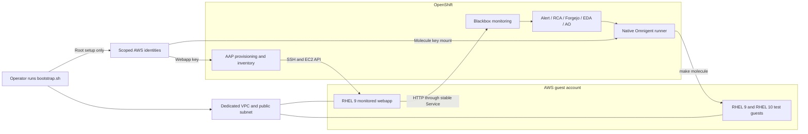

# AWS and CNV backends for the SELinux outage demo

Status: implementation in feature branches. AWS lifecycle checks have passed;
full platform bootstrap and the incident demo are still being validated.

Bootstrap must install the demo on OpenShift and provision its Linux targets
through either CNV or AWS. CNV remains the default and retains its current
behavior. AWS puts the monitored RHEL webapp and Molecule guests in a dedicated
VPC with a public subnet in the supplied AWS account. That account can differ
from the account hosting OpenShift.

The incident flow stays: fault job → alert → RCA → Forgejo issue → webhook →
EDA/AO → Omnigent session → tested PR → human merge → one human recovery job.
AO and Omnigent keep their independent provider/model settings.

## Backend selection

```bash
# Existing behavior on a fresh installation.
make bootstrap
bash bootstrap/bootstrap.sh --backend cnv

# AWS targets; platform services still run in the selected OpenShift cluster.
make bootstrap BACKEND=aws
bash bootstrap/bootstrap.sh --backend aws

# The same selector applies to maintenance commands.
make demo-reset BACKEND=aws
bash bootstrap/bootstrap.sh --backend aws webapp verify
```

Accept only `cnv` and `aws`. Resolve the backend from an explicit CLI argument,
then a nonempty `DEMO_BACKEND` input, then recorded deployment state, then `cnv`.
Make forwards `BACKEND` only when supplied. An empty input must not override
recorded AWS state during later commands. Existing command forms remain valid.

Record backend, AWS account/region when relevant, and a generated deployment
identifier before provisioning. Reject a selector or account that conflicts
with a live deployment. Switching backends requires tearing down the recorded
deployment first; a flag must not silently delete it or leave a second fleet.
Operator cluster commands always use `~/.kube/config`.

Preserve nonempty inherited backend/AWS inputs before loading `.env`, so its
empty placeholders cannot erase supplied credentials or selections.

| Component | CNV | AWS |
| --- | --- | --- |
| Monitored host | Existing RHEL 9 DataSource clone | RHEL 9 EC2 instance |
| Molecule hosts | Existing CentOS Stream 10 DataSource | RHEL 9 and RHEL 10 EC2 instances |
| Molecule backend selector | `PROVISIONER=kubevirt` | `PROVISIONER=aws` |
| Host access | Existing SSH Services / test PodIP | Public-IP SSH as `ec2-user` |
| Provisioning identity | Existing Kubernetes service accounts | Bootstrap-created scoped IAM users |
| Agent test credential | Existing scoped test kubeconfig | New scoped AWS access key |
| Platform storage | Existing selected RWO class | OpenShift's selected RWO class, including EBS |

All new bootstrap orchestration, input handling, IAM creation, network setup,
credential publication and lifecycle entry points belong in
`bootstrap/bootstrap.sh`. Do not add bootstrap helper scripts. Workload
playbooks, image build inputs and the shared Molecule backend remain in their
normal repositories.



## AWS assumptions from the reference tests

Use the inspected checkout of
[`acl-ready-to-use-content`](https://github.com/redhat-services-platform-team/acl-ready-to-use-content/tree/f2f5920d6a2bd25640aa688f85a92345afac9361),
revision `f2f5920d6a2bd25640aa688f85a92345afac9361`, as the AWS behavior reference.
Relevant files are `molecule/utils/inventory/base/group_vars/all.yml`,
`molecule/utils/inventory/linux/hosts.yml`,
`molecule/utils/provisioners/aws/{create,destroy}.yml`, and
`hack/create-molecule-iam-user.yml`. No credential file from that checkout is
an implementation input.

| Assumption | Demo AWS behavior |
| --- | --- |
| Region | `us-east-2` by default; configurable |
| VPC/subnet | Dedicated VPC and one public subnet; default CIDR `10.77.0.0/24` |
| Routing | Internet gateway, subnet route to `0.0.0.0/0`, public IPv4 assignment |
| Instance type | `t3.medium` by default, including Molecule guests |
| Linux images | Red Hat publisher `309956199498`; x86_64 HVM RHEL 9/10 name filters |
| AMI override | Exact AMI ID overrides name lookup |
| SSH | `ec2-user`, public IP, TCP 22; reference source CIDR `0.0.0.0/0`, configurable |
| Molecule SSH key | Per-run RSA 4096 PEM key; import its public half as an EC2 key pair |
| Connection readiness | EC2 running, then real SSH/Ansible connection wait |
| Resource ownership | `molecule_scenario=molecule-<scenario>` plus deployment and run identifiers |
| Test lifecycle | Create, prepare, converge, idempotence, verify, destroy |

The monitored webapp remains RHEL 9. AWS tests use both reference Linux hosts,
RHEL 9 and RHEL 10, in the single nginx scenario; adding hosts does not add
scenarios. Windows/WinRM support is outside this change.

Three adaptations are deliberate. Bootstrap owns the persistent VPC/subnet and
passes their IDs using the reference's existing-network mode. Resolved AMI IDs
are pinned in deployment state so resets do not select a different image.
Normal bootstrap reruns reuse IAM access keys rather than rotating them.

## Operator inputs

Bootstrap reads these fields from the protected `.env` or inherited environment.

| Input | Default / requirement |
| --- | --- |
| `DEMO_BACKEND` | Empty; fresh installs default to `cnv` |
| `AWS_BOOTSTRAP_ACCESS_KEY_ID` | Required for AWS setup; operator-supplied root/admin key ID |
| `AWS_BOOTSTRAP_SECRET_ACCESS_KEY` | Required for AWS setup; matching root/admin secret |
| `AWS_DEMO_ACCOUNT_ID` | Optional expected account; resolved and recorded on first setup |
| `AWS_DEMO_REGION` | `us-east-2` |
| `AWS_DEMO_AZ` | Optional; otherwise choose and record a supported AZ in that account |
| `AWS_DEMO_VPC_CIDR` | `10.77.0.0/24`; one subnet uses this range |
| `AWS_DEMO_SSH_CIDR` | `0.0.0.0/0`, matching the reference; operator may narrow it |
| `AWS_DEMO_HTTP_CIDR` | `0.0.0.0/0`; applies only to the monitored webapp |
| `AWS_WEBAPP_INSTANCE_TYPE` | `t3.medium` |
| `AWS_MOLECULE_INSTANCE_TYPE` | `t3.medium`; must be in the test IAM allowlist |
| `AWS_DEMO_ROOT_VOLUME_SIZE_GIB` | `30`; must be at least the selected AMI's minimum |
| `AWS_RHEL9_AMI_ID` | Optional exact ID; otherwise newest matching approved RHEL 9 image |
| `AWS_RHEL10_AMI_ID` | Optional exact ID; otherwise newest matching approved RHEL 10 image |

Root credentials come from the ignored, protected operator `.env` or inherited
environment. Pass them only to local bootstrap AWS calls, never through command
arguments, printed configuration, AAP credentials, Kubernetes Secrets, images,
AO inputs or agent prompts. Runtime AWS credentials use separate SDK sessions;
they must not inherit the operator's root environment.

CNV must not require AWS inputs, contact AWS, create IAM identities, or mount AWS
credentials. AWS must not require KVM, CNV CRDs, DataSources or the old Machine
API credential. Shared AAP license/model/identity requirements still apply.

AMI discovery checks publisher, architecture, image state, virtualization type,
root-device requirements and instance-type availability. Persist the selected
IDs; refresh only through an explicit image-input change or a new deployment.
Fail if either required test image is unavailable, rather than dropping a host.

## Credentials and IAM

The new key supplied to Omnigent is an **IAM access key**, distinct from the SSH
key used to log in to a guest. Bootstrap creates two deployment-specific IAM
users, their policies, and separate access keys:

| Identity | Consumer | Allowed ownership |
| --- | --- | --- |
| Webapp provisioner | AAP AWS credential and AWS inventory source | This deployment's webapp instances |
| Molecule provisioner | Native Omnigent coding/test runners | This deployment's disposable Molecule instances, SGs and EC2 key pairs |

The webapp IAM key also supplies filtered `amazon.aws.aws_ec2` inventory. Neither
runtime user has IAM administration or `iam:PassRole`; guests have no instance
profile. The agent's user cannot mutate or SSH into the monitored webapp.

Use the reference IAM policy's region-scoped `ec2:Describe*` reads. This covers
the status, attribute, network-interface, volume and tag reads denied by the
workshop Machine API identity, including the standard Ansible module's checks
after launch. Describe permissions can expose other EC2 metadata in the region;
inventory filters select the demo fleet but do not turn those reads into
resource-scoped IAM permissions.

Use these exact ownership keys on created resources:

| Tag | Value |
| --- | --- |
| `demojam:deployment` | Persisted deployment identifier |
| `demojam:purpose` | `network`, `webapp` or `molecule` |
| `molecule_scenario` | `molecule-<scenario>` on test-owned resources |
| `molecule_run_id` | Persisted invocation ID on test-owned resources |

Test names use `molecule-<deployment-id>-<scenario>-<run-id>`. Key-pair ARN
permissions include the deployment-specific prefix, rather than every
`molecule-*` key in the account. Network resources belong to bootstrap, not
to a scenario. IAM ownership predicates and cleanup selectors must agree.

For writes, enforce the following action/resource contract with separate
statements for EC2's multiple launch resource types:

- `RunInstances` requires the recorded deployment and purpose tags, selected
  subnet, permitted AMI publisher and instance type. Test launch types follow
  the reference's `t3.micro` through `t3.xlarge` allowlist, at most four vCPUs.
- `CreateTags` permits required tags at creation and reconciliation of already
  owned resources. It must not let either user adopt unrelated resources or
  remove/rewrite deployment/purpose ownership tags after creation.
- Termination and required instance-attribute updates apply only to instances
  with the same deployment ID and that user's purpose, `webapp` or `molecule`.
- The Molecule user can import/delete deployment-specific `molecule-*` EC2 key
  pairs and create/manage/delete its tagged test SG in the recorded VPC. It
  cannot change the webapp SG or create/delete VPCs, subnets, gateways or routes.
- Neither user can create IAM credentials, attach roles, or widen its policy.

The reference grants throwaway VPC plumbing to tests. This deployment uses its
supplied-network path, so that permission is unnecessary. The policy must be
checked against the actual Ansible AWS modules; a successful `RunInstances`
dry run alone is not an acceptance test. AWS documents
[tag-on-create authorization](https://docs.aws.amazon.com/AWSEC2/latest/UserGuide/supported-iam-actions-tagging.html)
and [EC2 action/resource conditions](https://docs.aws.amazon.com/service-authorization/latest/reference/list_ec2.html).

Create keys once and store them immediately in Kubernetes. On rerun, validate
and reuse the recorded key. If an IAM key exists but its Secret is missing,
stop with an explicit recovery/rotation action; AWS cannot return a lost secret
access key. Do not delete/recreate valid keys on every bootstrap. Rotation must
update mounted runners and AAP together before retiring the old key.

The Molecule Secret mounts read-only into the native runner's main container in
`omnigent-sandboxes`, where agent and independent-test commands execute. It
contains an AWS shared-credentials file; set `AWS_SHARED_CREDENTIALS_FILE` to
that mount and `AWS_REGION` to the selected region. The server, init containers
and image builds do not receive the test key. A nonsecret runtime profile supplies
backend, VPC/subnet, AMI IDs, SSH settings and ownership identifiers. Only those
approved runtime settings pass through the native harness.

The webapp SSH key remains bootstrap-generated and persistent across resets,
held only by AAP's Machine credential; its public half is imported into EC2.
Molecule generates its own SSH key and runtime connection inventory in the
scenario's ephemeral directory, following the reference. Destroy removes the
EC2 key pair and test resources before discarding that state.

## Network, monitored host and platform rollout

Bootstrap creates and records one tagged VPC, public subnet, internet gateway,
route table and association in the guest account. No default VPC, peering,
shared VPC, NAT gateway or Elastic IP is required. Public IPs are dynamic and
must be refreshed after replacement. The chosen AZ belongs to the guest
account; do not infer its subnet from the OpenShift node in another account.
Use AZ IDs if physical placement must be coordinated across accounts, per
[AWS AZ mapping documentation](https://docs.aws.amazon.com/global-infrastructure/latest/regions/az-ids.html).

EC2 root volumes use encrypted gp3 storage and `DeleteOnTermination=true`.
Validate the configured size against each AMI's minimum. Verify volume deletion
after instance termination; a terminated instance alone does not prove disk
cleanup. No additional data disks are needed for this change.

The webapp SG allows configured-source SSH on 22 and HTTP on 80. Test SGs allow
configured-source SSH on 22; HTTP checks run inside the guests. Outbound access
supports cloud initialization and package repositories. Validate actual SSH
from AAP and native runners, and HTTP from the blackbox exporter.

Keep the existing `webapp-vms` namespace, `webapp` Service, login proxy, Route,
probe and alert labels. In AWS mode remove the Service's KubeVirt selector and
reconcile an EndpointSlice containing the EC2 public HTTP address. The same
stable Service DNS name remains the login proxy upstream and monitoring target.
The AWS provisioning job owns endpoint updates; GitOps must not prune or revert
that runtime EndpointSlice. Delete it when the webapp is removed. This uses
[Kubernetes Services without selectors](https://kubernetes.io/docs/concepts/services-networking/service/#services-without-selectors).

AAP registers only the selected host-discovery source. AWS inventory filters
on deployment ID, purpose `webapp`, and live instance state, composes the public
address, and puts the host in `webapps`. Use `ec2-user` consistently in inventory
and the Machine credential. Test guests and the OCP node must never enter that
group. `webapp_vm` keeps its job name but selects the backend's provisioning
playbook. Existing `webapp_nginx`, audit and SELinux job names remain usable.

For AWS RHEL AMIs, use their configured package repositories; skip the
workshop-only manifest entitlement installation/CDN rewrite. CNV keeps its
existing entitlement path. Neither the collection nor nginx deployment
changes SELinux mode. Initial provisioning is followed by the separate
permissive setup job, then nginx installation. Recovery after the fault remains
one nginx job with SELinux still Enforcing.

AWS rollout omits the CNV Application, OS-image namespace creation, VM-specific
RBAC/quotas and all CNV/DataSource readiness checks. The webapp networking app
still deploys, with its AWS form. CNV renders the current resources and waits.
Both modes retain GitOps, Pipelines, sandbox operator, CNPG, AAP, AO, Omnigent,
Forgejo, RHDH, identity and monitoring. EBS-backed RWO PVCs remain sufficient;
preserve an already working S3-backed image registry.

Verify the pinned supported AAP EE contains the required AWS collection and
SDKs. If it does not, bootstrap builds an AWS-only EE variant from that pinned
supported base, with tested dependency pins. CNV continues to use the existing
EE. Preload the AWS collections and SDKs into the agent image's Ansible Python
environment as well; avoid dependency installation during incident execution.

Register the generic `openshift_virtualization_machine` job and display CNV
console links only in CNV mode. AWS homepage/status links identify the EC2
webapp instead. Publish the selected runtime profile and Secrets before Argo
applies workloads that require their mounts; missing inactive-backend Secrets
must not block readiness.

## Shared Molecule contract

The shared provisioner adds the `aws` backend alongside Podman, Docker, QEMU
and KubeVirt. The template, webapp collection and sandbox require `0.0.7-alpha`.
The sandbox downloads that published Galaxy artifact, checks its SHA-256 in
the Containerfile and preloads it before resolving the other pinned requirements.
Consumer dependency setup uses that release. AWS lifecycle tasks stay in the
shared provisioner; scenarios retain the public create/prepare/destroy imports.

Keep Ansible-native Molecule configuration, the public shared create/prepare/
destroy dispatchers, and `make molecule` → `molecule test --all`. Each scenario
still contains only `molecule.yml`, `converge.yml` and `verify.yml`. Common
inventory loads first, then the selected backend's declarative host layer,
then runtime connection inventory. Static desired-state inventory must not
overwrite generated connection variables.

Map the deployed selector into `PROVISIONER=kubevirt|aws`; the backend-specific
inventory chooses CentOS Stream 10 for CNV or RHEL 9/10 for AWS. Map runtime
profile inputs explicitly into shared inventory rather than assuming arbitrary
environment variables are understood by the provisioner. AWS host specs expose
AMI ID/name/owner, expected distribution/version, instance type, network and
SSH inputs. The reference's `MOLECULE_AWS_VPC_ID` and
`MOLECULE_AWS_SUBNET_ID` are supplied by bootstrap, so the tests reuse the shared
network and never destroy it.

Bootstrap also creates a test security group and exports its ID and the expected
AWS account in the sandbox profile. Shared inventory maps them to
`security_groups` and `expected_account_id`, with `network.mode: existing`.
Both guests use encrypted gp3 `root_disk` settings and explicit deployment/purpose
tags. The provisioner injects its generated local SSH key through cloud-init.
The test identity can launch into the exact shared group, but cannot change or
delete it. Normal resets retain the group; full teardown removes it after guests.
Generated instances, disks and interfaces carry both deployment tags and the
provisioner's own run tags, so scoped cleanup retains both ownership checks.

Use a per-invocation run ID alongside `molecule_scenario`, deployment ID and
purpose tags. Persist resource IDs and backend in Molecule's ephemeral state.
Create and destroy use the same identity; `make destroy` must work after a
partial create failure. Independent PR-head tests use a separate source export,
installation directory and run ID. One agent runs the demo; no scheduling or
serialization system is added.

Preserve behavioral verification: target OS/version, HTTP response and actual
nginx worker identity, plus the full idempotence/destroy sequence. The nginx
role remains the content under test. Backend configuration must not prescribe
the SELinux fix to the coding agent.

The reference uses AWS collection bounds `>=9,<12`. Select and test an exact
compatible version during implementation, then align AAP, provisioner,
template, webapp collection and sandbox dependencies. The earlier inventory
probe with `amazon.aws 12.0.0` is not proof that the reference lifecycle has
been validated with that version.

## State, reset and teardown

Keep nonsecret backend/account/region, deployment identity, resource IDs,
resolved AMIs and ownership in deployment state. Keep access keys and SSH
private material in separate Secrets. Retain a protected ignored local state
receipt so cloud cleanup can still identify the deployment if the cluster is
lost. It must not contain root credentials or become a committed report.

Normal bootstrap reuses the network, identities, keys and existing healthy
webapp. It reconciles backend configuration without recreating the fleet.
Before any destructive operation, verify target account, region, recorded
deployment and resource ownership. Never delete by VPC membership, scenario
name or broad `molecule-*` prefix alone.

`demo-reset` stops incident producers and running demo jobs/runners, removes
this deployment's webapp and disposable test resources, clears its incident
state, and preserves AAP, network and credentials. The next bootstrap creates
the clean permissive webapp baseline. It does not rotate keys or resolve new
AMI versions.

Full teardown stops consumers, revokes runtime keys, terminates owned guests,
verifies owned EBS deletion and ENI release, removes owned SGs/key pairs, then
deletes the recorded subnet/routes/IGW/VPC and IAM users/policies. Never delete
the operator-provided root key or the OCP host/network in another account.
`--keep-aap` preserves AAP and its data but still removes this demo's AWS
resources and runtime AWS credentials. Root bootstrap credentials are required
for IAM/network teardown; report exact remaining owned resources if cleanup
cannot finish, and retain the state receipt.

## Implementation sequence

| Step | Repositories and files | Verification |
| --- | --- | --- |
| 1. Backend/state contract | GitOps `bootstrap/bootstrap.sh`, `.env.example`, Makefile | Default CNV, selector precedence, invalid selector, account/backend mismatch before mutation |
| 2. AWS bootstrap resources | Same script; backend rendering for cluster Applications and runtime mounts | IAM key reuse, public network/placement, negative ownership tests, partial-setup recovery |
| 3. AAP host lifecycle | `demojam-ansible` inventory/CaC, AWS provisioning playbook, repository-mode selection | Real create/discovery/SSH, Service endpoint update, permissive baseline; all existing job names preserved |
| 4. Shared AWS tests | `david_igou.molecule_provisioners` AWS backend and release; template/webapp collection shared inventory and requirements | RHEL 9/10 lifecycle, HTTP/worker assertions, idempotence, destroy after partial failure |
| 5. Sandbox/EE integration | GitOps image requirements/profile and conditional sandbox config; AWS AAP EE if required | Native harness and independent runner both load the selected backend and their own scoped identity |
| 6. Lifecycle/docs | Same bootstrap script, repo guides and run-demojam skill | Reset twice without extra keys/resources; full teardown and fresh bootstrap; no automatic incident deadline |

The reference checkout provides assumptions and reusable lifecycle logic. No
changes to its existing tests or credential files are required by this demo.
Implementation branches must be based on the current main of each affected
repository; carry the already proposed demo changes as needed, and list the
shared provisioner repository as a separate dependency change.

## Acceptance tests

1. Fresh CNV bootstrap with no AWS credentials deploys the current stack and
   runs CentOS Stream 10 Molecule. Omitting the selector behaves as before.
2. Fresh AWS bootstrap on OCP without KVM creates the dedicated public network,
   RHEL 9 webapp, scoped keys and all platform wiring from one entry point.
   There is no attempted CNV API call, installation or image wait.
3. Native `make molecule` runs every discovered scenario on both RHEL 9/10
   AWS guests using the mounted test identity. Full lifecycle and cleanup pass.
   Independent tests of the published PR head use the same backend contract.
4. The test identity can run the real Ansible lifecycle and inspect volume
   deletion, but cannot alter the webapp, mutate unrelated resources, remove
   ownership tags, change IAM, launch an instance profile, or select a forbidden
   subnet/region/image publisher/instance type. IAM has no instance-count cap;
   the allowlist and account quota do not establish one.
5. Rerun bootstrap and perform two reset/bootstrap cycles. Record identical
   network/key identities, stable AMI IDs, no leaked guests/disks/key pairs,
   and no need to manually register inventory or endpoints.
6. Run one unattended incident on each backend. Require fault → alert → RCA →
   issue → webhook → EDA/AO → native session → PR. Merge only after the exact
   head passes tests; run one recovery job and verify Enforcing, healthy HTTP,
   probe success and resolved alerts. No review feedback, corrective prompt,
   manual dispatch or agent repair is allowed. Record stage timings and prompts.
7. Test full and keep-AAP teardown, plus cleanup using the retained state receipt.
   Confirm all owned AWS resources and created keys are gone; foreign resources
   and the OCP cluster remain intact. Scan tracked content/history and logs for
   root/runtime credentials before publishing evidence.

No AWS root credentials or new-account resources are needed to review this
specification. The shared provisioner is owned by its separate implementation
thread.
